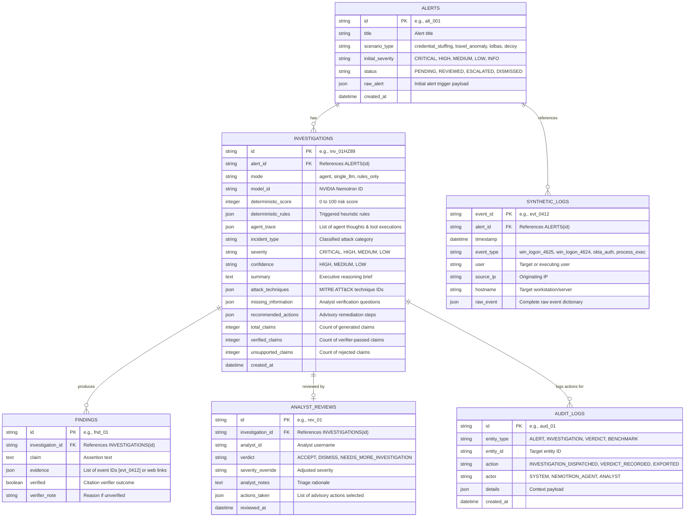

# Backend Database Schema & Data Models Specification
## SignalDesk AI — Persistence Layer & Data Models

---

### Document Metadata
- **Project Name:** SignalDesk AI
- **Document Version:** 2.0.0 (Agent Trace, Synthetic Logs & Citation Models)
- **Database Engine:** SQLite 3 (WAL mode) / PostgreSQL 15+ compatible
- **ORM:** SQLAlchemy 2.0
- **Validation:** Pydantic v2
- **Last Updated:** 2026-10-18

---

## 1. Entity-Relationship (ER) Diagram



---

## 2. SQL DDL Statements (SQLite & PostgreSQL Compatible)

```sql
-- 1. Alerts Table
CREATE TABLE IF NOT EXISTS alerts (
    id VARCHAR(36) PRIMARY KEY,
    title VARCHAR(255) NOT NULL,
    scenario_type VARCHAR(64) NOT NULL,
    initial_severity VARCHAR(32) NOT NULL DEFAULT 'MEDIUM',
    status VARCHAR(32) NOT NULL DEFAULT 'PENDING',
    raw_alert TEXT NOT NULL,
    created_at TIMESTAMP NOT NULL DEFAULT CURRENT_TIMESTAMP
);

-- 2. Synthetic Event Logs Table
CREATE TABLE IF NOT EXISTS synthetic_logs (
    event_id VARCHAR(36) PRIMARY KEY,
    alert_id VARCHAR(36) NOT NULL,
    timestamp TIMESTAMP NOT NULL,
    event_type VARCHAR(64) NOT NULL,
    user VARCHAR(128),
    source_ip VARCHAR(45),
    hostname VARCHAR(128),
    raw_event TEXT NOT NULL,
    CONSTRAINT fk_log_alert FOREIGN KEY (alert_id) REFERENCES alerts(id) ON DELETE CASCADE
);

CREATE INDEX IF NOT EXISTS idx_logs_alert_id ON synthetic_logs(alert_id);
CREATE INDEX IF NOT EXISTS idx_logs_source_ip ON synthetic_logs(source_ip);
CREATE INDEX IF NOT EXISTS idx_logs_user ON synthetic_logs(user);

-- 3. Investigations Table
CREATE TABLE IF NOT EXISTS investigations (
    id VARCHAR(36) PRIMARY KEY,
    alert_id VARCHAR(36) NOT NULL,
    mode VARCHAR(32) NOT NULL DEFAULT 'agent',
    model_id VARCHAR(128) NOT NULL,
    deterministic_score INTEGER NOT NULL DEFAULT 0,
    deterministic_rules TEXT NOT NULL DEFAULT '[]',
    agent_trace TEXT NOT NULL DEFAULT '[]',
    incident_type VARCHAR(128) NOT NULL,
    severity VARCHAR(32) NOT NULL,
    confidence VARCHAR(32) NOT NULL DEFAULT 'medium',
    summary TEXT NOT NULL,
    attack_techniques TEXT NOT NULL DEFAULT '[]',
    missing_information TEXT NOT NULL DEFAULT '[]',
    recommended_actions TEXT NOT NULL DEFAULT '[]',
    total_claims INTEGER NOT NULL DEFAULT 0,
    verified_claims INTEGER NOT NULL DEFAULT 0,
    unsupported_claims INTEGER NOT NULL DEFAULT 0,
    created_at TIMESTAMP NOT NULL DEFAULT CURRENT_TIMESTAMP,
    CONSTRAINT fk_inv_alert FOREIGN KEY (alert_id) REFERENCES alerts(id) ON DELETE CASCADE
);

-- 4. Findings Table
CREATE TABLE IF NOT EXISTS findings (
    id VARCHAR(36) PRIMARY KEY,
    investigation_id VARCHAR(36) NOT NULL,
    claim TEXT NOT NULL,
    evidence TEXT NOT NULL DEFAULT '[]',     -- Stored as JSON array of event/web citations
    verified BOOLEAN NOT NULL DEFAULT 0,
    verifier_note TEXT,
    CONSTRAINT fk_fnd_inv FOREIGN KEY (investigation_id) REFERENCES investigations(id) ON DELETE CASCADE
);

-- 5. Analyst Reviews Table
CREATE TABLE IF NOT EXISTS analyst_reviews (
    id VARCHAR(36) PRIMARY KEY,
    investigation_id VARCHAR(36) NOT NULL UNIQUE,
    analyst_id VARCHAR(64) NOT NULL,
    verdict VARCHAR(64) NOT NULL,
    severity_override VARCHAR(32),
    analyst_notes TEXT,
    actions_taken TEXT DEFAULT '[]',
    reviewed_at TIMESTAMP NOT NULL DEFAULT CURRENT_TIMESTAMP,
    CONSTRAINT fk_rev_inv FOREIGN KEY (investigation_id) REFERENCES investigations(id) ON DELETE CASCADE
);

-- 6. Audit Logs Table
CREATE TABLE IF NOT EXISTS audit_logs (
    id VARCHAR(36) PRIMARY KEY,
    entity_type VARCHAR(64) NOT NULL,
    entity_id VARCHAR(36) NOT NULL,
    action VARCHAR(64) NOT NULL,
    actor VARCHAR(64) NOT NULL,
    details TEXT,
    created_at TIMESTAMP NOT NULL DEFAULT CURRENT_TIMESTAMP
);
```

---

## 3. Pydantic v2 Ingestion, Agent & API Schemas

```python
"""
backend/schemas/models.py
Strict Pydantic v2 models for Agent Tooling, Findings, and Evaluation.
"""

from typing import List, Dict, Any, Optional
from pydantic import BaseModel, Field
from datetime import datetime

# --- Synthetic Log Model ---
class SyntheticLogItem(BaseModel):
    event_id: str = Field(..., example="evt_0412")
    alert_id: str
    timestamp: str
    event_type: str
    user: Optional[str] = None
    source_ip: Optional[str] = None
    hostname: Optional[str] = None
    raw_event: Dict[str, Any]

# --- Agent Trace Models ---
class AgentTraceStep(BaseModel):
    step: int
    action: str = Field(..., description="Tool name: search_logs, correlate_events, build_timeline, map_attack, web_lookup")
    input: Dict[str, Any]
    thought: Optional[str] = None
    result_summary: str

# --- Findings & Citations Model ---
class FindingItem(BaseModel):
    claim: str = Field(..., description="Factual claim extracted by agent")
    evidence: List[str] = Field(..., description="List of event IDs (evt_XXXX) or web citations (web:tavily:...)")
    verified: bool = Field(default=False, description="Evaluated by Citation Verifier")
    verifier_note: Optional[str] = None

# --- Complete Investigation Output ---
class InvestigationBrief(BaseModel):
    incident_type: str
    severity: str = Field(..., example="high")
    confidence: str = Field(..., example="medium")
    findings: List[FindingItem]
    attack_techniques: List[str] = Field(default_factory=list)
    missing_information: List[str] = Field(default_factory=list)
    recommended_actions: List[str] = Field(default_factory=list)
    human_review_required: bool = True

class VerifierMetrics(BaseModel):
    total_claims: int
    verified_claims: int
    unsupported_claims_caught: int

class InvestigationResponse(BaseModel):
    investigation_id: str
    alert_id: str
    mode: str = "agent"
    deterministic_risk: Dict[str, Any]
    agent_trace: List[AgentTraceStep]
    brief: InvestigationBrief
    verifier_metrics: VerifierMetrics

# --- Analyst Verdict Submission ---
class VerdictSubmission(BaseModel):
    analyst_id: str = "analyst_1"
    verdict: str = Field(..., example="ACCEPT")  # ACCEPT, DISMISS, NEEDS_MORE_INVESTIGATION
    analyst_notes: str
    severity_override: Optional[str] = None
    actions_taken: List[str] = Field(default_factory=list)

# --- Benchmark Metric Models ---
class BenchmarkResult(BaseModel):
    approach: str = Field(..., example="SignalDesk agent + verifier")
    precision: float
    recall: float
    f1: float
    unsupported_claims_caught: int
    avg_latency_seconds: float
```
