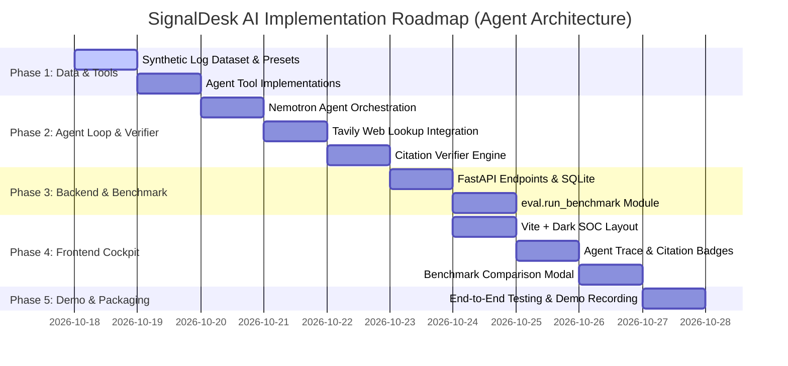

# Phased Implementation Plan
## SignalDesk AI — Production Delivery Roadmap

---

### Document Metadata
- **Project Name:** SignalDesk AI
- **Document Version:** 2.0.0 (Agent Loop, Tavily Threat Intel & Verifier Architecture)
- **Track:** Apps & Agents — Nebius x NVIDIA Global AI Hackathon
- **Last Updated:** 2026-10-18

---

## 1. Updated Project Directory Layout

```text
signaldesk-ai/
├── README.md
├── error.md                       # Error catalog, edge cases & diagnostic queries
├── requirements.txt               # Backend Python dependencies
├── .env.example                   # Environment configuration template
├── docs/                          # Architecture & Planning Documentation
│   ├── PRD.md                     # Product Requirements Document
│   ├── TRD.md                     # Technical Requirements Document
│   ├── UI_UX_DESIGN_APP_FLOW.md   # Design System & User Journey
│   ├── BACKEND_SCHEMA.md          # Database & Pydantic Data Models
│   └── IMPLEMENTATION_PLAN.md     # Engineering Roadmap (This File)
├── backend/                       # FastAPI Application
│   ├── __init__.py
│   ├── main.py                    # Application entry point & router mounting
│   ├── config.py                  # Pydantic BaseSettings & env loader
│   ├── database.py                # SQLite / SQLAlchemy 2.0 session factory
│   ├── models/                    # ORM Database Models
│   │   ├── __init__.py
│   │   └── database.py
│   ├── schemas/                   # Pydantic v2 validation models
│   │   ├── __init__.py
│   │   └── models.py
│   ├── rules/                     # Deterministic Heuristic Engine
│   │   ├── __init__.py
│   │   ├── engine.py              # Rule orchestrator
│   │   └── heuristics.py          # Heuristic implementations
│   ├── agent/                     # Multi-Step Investigation Agent Loop
│   │   ├── __init__.py
│   │   ├── orchestrator.py        # Nemotron reasoning controller
│   │   ├── prompts.py             # Agent system prompt & tool specs
│   │   └── tools.py               # search_logs, correlate, timeline, ATT&CK, web_lookup
│   ├── verifier/                  # Deterministic Citation Verifier
│   │   ├── __init__.py
│   │   └── citation_verifier.py   # Validates evt_XXXX existence & attribute fidelity
│   ├── services/                  # Business Logic & Case Management
│   │   ├── __init__.py
│   │   ├── alert_service.py
│   │   ├── log_service.py         # Synthetic log store query interface
│   │   └── export_service.py      # Markdown & JSON exporter
│   └── data/                      # Synthetic Pre-loaded Alerts & Logs
│       ├── __init__.py
│       ├── dataset.py             # Labeled benchmark scenarios & decoy events
│       └── presets.py             # Pre-configured demo scenarios
├── eval/                          # Quantitative Benchmark Harness
│   ├── __init__.py
│   ├── run_benchmark.py           # Compares Rules vs. Single LLM vs. Agent+Verifier
│   └── metrics.py                 # Precision, Recall, F1 & Latency calculator
├── frontend/                      # React 18 + Vite SPA
│   ├── package.json
│   ├── vite.config.js
│   ├── index.html
│   └── src/
│       ├── main.jsx
│       ├── App.jsx
│       ├── index.css              # Dark mode SOC Design System & tokens
│       ├── components/
│       │   ├── TopNav.jsx         # Metrics counters & Provider status pills
│       │   ├── AlertExplorer.jsx  # Scenario list & decoy selector
│       │   ├── LogViewer.jsx      # Raw synthetic event stream (evt_XXXX inspector)
│       │   ├── AgentTrace.jsx     # Step-by-step tool execution accordion
│       │   ├── FindingsCard.jsx   # Verified claims with interactive citation pills
│       │   ├── VerdictHub.jsx     # Analyst review decision & export CTA
│       │   └── BenchmarkModal.jsx # Live benchmark comparison modal
│       ├── services/
│       │   └── api.js             # Typed API client for FastAPI endpoints
│       └── utils/
│           └── formatters.js      # Date & log formatters
└── tests/                         # Pytest Validation Suite
    ├── __init__.py
    ├── test_agent_tools.py        # Unit tests for the 5 tools
    ├── test_verifier.py           # Citation validation & hallucination detection tests
    ├── test_nebius_client.py      # Nebius inference integration tests
    └── test_api.py                # FastAPI endpoint integration tests
```

---

## 2. Milestone Execution Roadmap



---

## 3. Detailed Step-by-Step Execution Plan

### Phase 1: Synthetic Dataset & Agent Tools
- [ ] Create `requirements.txt`:
  ```text
  fastapi>=0.110.0
  uvicorn>=0.28.0
  pydantic>=2.6.0
  pydantic-settings>=2.2.0
  sqlalchemy>=2.0.0
  httpx>=0.27.0
  openai>=1.20.0
  tavily-python>=0.3.0
  pytest>=8.0.0
  python-dotenv>=1.0.0
  ```
- [ ] Create `.env.example`:
  ```dotenv
  NEBIUS_API_KEY=your_key_here
  NEBIUS_BASE_URL=https://api.tokenfactory.nebius.com/v1/
  NEBIUS_MODEL_ID=nvidia/Llama-3_1-Nemotron-70B-Instruct-HF
  TAVILY_API_KEY=your_key_here
  DATABASE_URL=sqlite:///./signaldesk.db
  ```
- [ ] Implement `backend/data/dataset.py`:
  - Attack scenario 1: Credential stuffing (`evt_0401` to `evt_0437`)
  - Attack scenario 2: Impossible travel anomaly (`evt_0501` to `evt_0506`)
  - Attack scenario 3: LOLBAS ransomware staging (`evt_0601` to `evt_0615`)
  - Attack scenario 4: AWS IAM privilege escalation (`evt_0701` to `evt_0710`)
  - Decoy scenario 5: Benign scheduled maintenance backup (`evt_0801` to `evt_0805`)
- [ ] Implement the 5 read-only tools in `backend/agent/tools.py`:
  - `search_logs(query, field, limit)`
  - `correlate_events(pivot_field, pivot_value, time_window_minutes)`
  - `build_timeline(event_ids)`
  - `map_attack(behavior_description)`
  - `web_lookup(query)` using Tavily Search API with offline fallback mocking.

### Phase 2: Agent Orchestration & Citation Verifier
- [ ] Implement `backend/agent/orchestrator.py`:
  - Multi-step loop with NVIDIA Nemotron on Nebius Token Factory.
  - JSON function calling / tool dispatch protocol.
  - Maximum 6 iteration guardrail.
- [ ] Implement `backend/verifier/citation_verifier.py`:
  - Parse `findings[].evidence` items.
  - Check `evt_XXXX` presence in the synthetic log database.
  - Check attribute fidelity (IP, username, counts).
  - Check web citations against Tavily query response cache.
  - Tag claims with `verified: true/false`.
- [ ] Implement `backend/rules/engine.py`:
  - Deterministic heuristics running separately from the agent.

### Phase 3: REST API & Evaluation Benchmark Harness
- [ ] Implement FastAPI routes in `backend/main.py`:
  - `GET /api/v1/alerts`
  - `GET /api/v1/alerts/{id}`
  - `POST /api/v1/alerts/{id}/investigate` (supports `mode=agent`, `single_llm`, `rules_only`)
  - `POST /api/v1/investigations/{id}/verdict`
  - `GET /api/v1/benchmark`
  - `GET /api/v1/cases/{id}/export`
- [ ] Implement `eval/run_benchmark.py`:
  - Run all dataset scenarios against the three approaches.
  - Compute Precision, Recall, F1, Hallucinations caught, and Latency.
  - Print formatted markdown summary table.

### Phase 4: Frontend Development (React 18 + Vite)
- [ ] Set up Vite React frontend in `frontend/`.
- [ ] Implement `index.css` with dark SOC theme, cyber tokens, and monospace styling.
- [ ] Build UI components:
  - `TopNav`: Status badges for Nebius Token Factory & Tavily; Benchmark runner trigger.
  - `LogViewer`: Searchable synthetic log view with highlighting.
  - `AgentTrace`: Interactive step accordion showing agent thoughts and tool calls.
  - `FindingsCard`: Verified findings with clickable `[evt_XXXX]` citation pills that focus the corresponding log.
  - `VerdictHub`: Analyst decision selector (Accept, Dismiss, Needs More Info) and Markdown exporter.
  - `BenchmarkModal`: Display benchmark comparative results.

### Phase 5: Verification & Demo Recording
- [ ] Run Pytest suite (`pytest tests/`).
- [ ] Execute `python -m eval.run_benchmark` to populate empirical metrics.
- [ ] Record short walkthrough demo showing live inference and citation verification.
