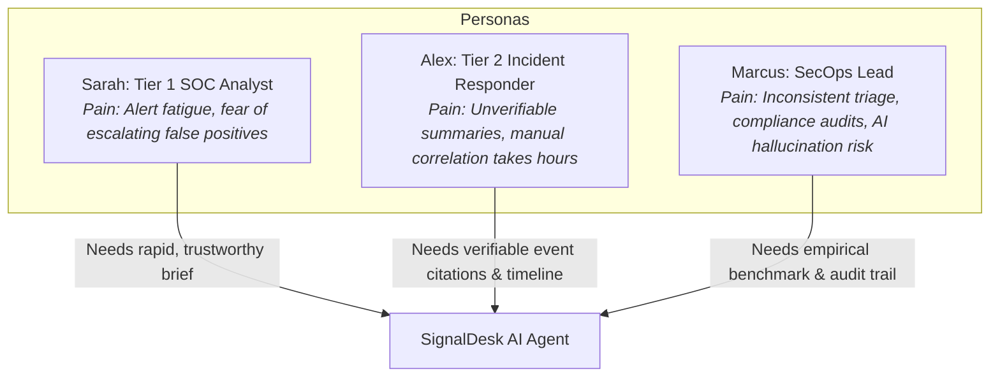

# Product Requirements Document (PRD)
## SignalDesk AI — Evidence-Verified Security Investigation Agent

---

### Document Metadata
- **Project Name:** SignalDesk AI
- **Document Version:** 2.0.0 (Updated to Agent + Citation Verifier Architecture)
- **Hackathon Track:** Apps & Agents — [Nebius x NVIDIA Global AI Hackathon](https://nebiusglobalaihackathon.devpost.com/)
- **Core AI Inference:** NVIDIA Nemotron via Nebius Token Factory
- **External Threat Intelligence:** Tavily Live Web Search
- **Status:** Approved for Implementation
- **Last Updated:** 2026-10-18

---

## 1. Executive Summary & Vision

### 1.1 The Idea
Security analysts do not need another generic AI tool that merely summarizes an alert and says "this looks suspicious." They need an **investigation they can verify and trust**. 

**SignalDesk AI** is an evidence-verified security investigation agent that works like a human analyst:
1. **Multi-step Agent Loop:** Rather than a single prompt-and-answer, the agent autonomously executes a multi-step investigation loop using dedicated read-only tools:
   - `search_logs`: Query synthetic security logs and SIEM telemetry.
   - `correlate_events`: Pivot across related events by account, source IP, or temporal proximity.
   - `build_timeline`: Reconstruct ordered, chronological attack timelines.
   - `map_attack`: Map observed malicious behaviors to MITRE ATT&CK techniques.
   - `web_lookup`: Query live threat intelligence via **Tavily** for IP reputation, known CVEs, and adversary context.
2. **Deterministic Citation Verifier:** Before any finding reaches the analyst, a deterministic code verifier inspects every claim. Every finding must cite real event IDs (e.g., `evt_0412`) or web threat intelligence references (e.g., `web:tavily:result_2`). Unsupported claims are automatically flagged or purged.
3. **Transparent Decision Support:** SignalDesk AI never takes autonomous destructive actions (no blocking IPs or terminating sessions). An analyst reviews verified findings and decides whether to accept, dismiss, or escalate.
4. **Empirical Benchmark:** Built-in evaluation suite (`eval.run_benchmark`) comparing Rules-Only vs. Single LLM Call vs. SignalDesk Agent + Verifier on precision, recall, F1, and caught hallucinations.

---

## 2. Goals & Non-Goals

### 2.1 Goals (In-Scope for Hackathon Build)
- **G-1: Agent Loop with Tool Calling:** Execute an autonomous investigation loop using NVIDIA Nemotron on Nebius Token Factory with 5 core tools (`search_logs`, `correlate_events`, `build_timeline`, `map_attack`, `web_lookup`).
- **G-2: Tavily Threat Intel Integration:** Fetch live reputation data, CVE details, and exploit patterns for suspicious IPs, domains, and processes.
- **G-3: Deterministic Citation Verifier:** Validate that every cited `evt_XXXX` exists in the log database and that the cited attributes match the claim.
- **G-4: Separate Heuristic Risk Scoring:** Run transparent deterministic rule scoring side-by-side with the agent's findings.
- **G-5: Human-in-the-Loop Cockpit:** A responsive 3-column analyst interface displaying raw events, agent thought trace, verified findings with citation links, and verdict actions.
- **G-6: Empirical Benchmark Harness:** Reproducible test suite evaluating detection metrics and hallucination rejection rates across a labeled synthetic attack dataset.
- **G-7: Audit Trail & Case Export:** Full history logging with one-click export to structured Markdown and JSON reports.

### 2.2 Non-Goals
- **NG-1:** No autonomous response actions (no automatic firewall rule creation, host isolation, or account locking). The agent's tools are strictly **read-only**.
- **NG-2:** Not an air-gapped system: event context is dispatched to Nebius Token Factory, and threat queries are dispatched to Tavily.
- **NG-3:** Not a replacement for a Tier 3 SOC or live production SIEM deployment; uses high-fidelity synthetic security logs for zero-setup demonstrations.

---

## 3. Comparison: Typical AI Triage vs. SignalDesk AI

| Capability | Typical "AI Alert Triage" | SignalDesk AI |
|---|---|---|
| **Architecture** | Single-shot prompt -> single response | Multi-step agent loop with specialized tool calls |
| **Evidence Basis** | Model opinion presented as factual truth | Every claim must cite specific event IDs (`evt_XXXX`) |
| **Hallucination Control** | Unchecked; hallucinations go unnoticed | Deterministic Citation Verifier checks each citation against logs |
| **External Intelligence** | Frozen weights / no live internet | Live threat-intel and reputation lookups via **Tavily** |
| **Scientific Validation** | Anecdotal assertions ("95% accurate") | Quantitative benchmark (`python -m eval.run_benchmark`) |
| **Analyst Agency** | Black-box output | Decision-support with interactive citation drill-down |

---

## 4. User Personas & Pain Points

---

## 5. Functional Requirements (FR)

### FR-1: Synthetic Log & Alert Store
- **FR-1.1:** Provide pre-indexed synthetic security event logs containing realistic attack sequences (Credential Stuffing, Impossible Travel, LOLBAS / Ransomware staging, AWS IAM Privilege Escalation) as well as benign decoy traffic.
- **FR-1.2:** Assign unique immutable identifiers (`evt_0001`, `evt_0002`, etc.) with timestamps, usernames, source IPs, hostnames, and process trees.

### FR-2: Agent Loop & Tool Calling Architecture
- **FR-2.1:** Orchestrate multi-turn reasoning with NVIDIA Nemotron via Nebius Token Factory.
- **FR-2.2:** Support 5 read-only agent tools:
  1. `search_logs(query, filters, limit)`: Search the event log database.
  2. `correlate_events(field, value, time_window)`: Identify related events linking accounts, IPs, or hosts.
  3. `build_timeline(event_ids)`: Chronologically arrange identified events into an attack narrative.
  4. `map_attack(behavior_description)`: Cross-reference MITRE ATT&CK techniques.
  5. `web_lookup(query)`: Query **Tavily** for IP reputation, known threat actors, and CVE telemetry.
- **FR-2.3:** Limit agent execution to a configurable maximum of 6 iterations to prevent runaway execution.

### FR-3: Deterministic Citation Verifier
- **FR-3.1:** Parse the model's draft brief containing `findings` and `evidence` citations.
- **FR-3.2:** Execute deterministic checks:
  - Verify every `evt_XXXX` exists in the active log store.
  - Verify that the cited event actually contains the claimed attributes (e.g., matching IP, timestamp, or failure count).
  - Verify that web citations (`web:tavily:...`) reference retrieved Tavily search results.
- **FR-3.3:** Mark each claim as `verified: true` or `verified: false`.
- **FR-3.4:** Reject or visibly flag ungrounded claims in the analyst interface.

### FR-4: Heuristic Risk Factor Engine
- **FR-4.1:** Compute rule-based risk factors completely independently of the agent reasoning.
- **FR-4.2:** Rules include: Rapid authentication failure bursts, post-failure success from identical IP, impossible geo-velocity, and known LOLBAS process strings.
- **FR-4.3:** Display rule score (0-100) side-by-side with the agent's confidence rating.

### FR-5: Analyst Investigation Cockpit (UI/UX)
- **FR-5.1:** 3-column dark-mode cockpit:
  - **Left:** Raw Telemetry, Event Inspector & Independent Rule Scores.
  - **Center:** Agent Execution Trace (tool calls, thoughts) & Verified Findings with clickable event citation badges.
  - **Right:** Human Verdict Hub (Accept, Dismiss, Needs More Info), remediation checklist, and export actions.
- **FR-5.2:** Clicking an event citation (e.g., `evt_0412`) instantly scrolls and highlights the exact event in the left-hand log viewer.
- **FR-5.3:** Real-time visual indicator for Nebius Token Factory and Tavily connection states.

### FR-6: Benchmark & Evaluation Suite
- **FR-6.1:** Implement `python -m eval.run_benchmark` executing:
  - Baseline 1: Rules-only detection.
  - Baseline 2: Single LLM call (zero-shot prompt).
  - Test Target: SignalDesk Agent + Citation Verifier.
- **FR-6.2:** Calculate and display: Precision, Recall, F1 Score, Hallucinations/Unsupported Claims Caught, and Average Latency per case.

### FR-7: Persistence & Case Export
- **FR-7.1:** Save full investigation briefs, tool execution traces, verifier logs, and analyst verdicts in SQLite.
- **FR-7.2:** Export investigation briefs to formatted Markdown and JSON with one click.

---

## 6. Non-Functional Requirements (NFR)

| ID | Category | Requirement | Target Metric |
|---|---|---|---|
| **NFR-1** | Agent Latency | Total agent loop runtime (including tools & Tavily) | < 8.0 seconds per case |
| **NFR-2** | Verifier Accuracy | Deterministic citation validation execution | 100% deterministic, < 50ms |
| **NFR-3** | Safety | Read-only enforcement | 0 write/delete/execute tools exposed to LLM |
| **NFR-4** | Secret Hygiene | API key security | `NEBIUS_API_KEY` and `TAVILY_API_KEY` never sent to client |
| **NFR-5** | Reliability | Offline / Mock fallback | Seamless fallback for local development if keys are absent |
