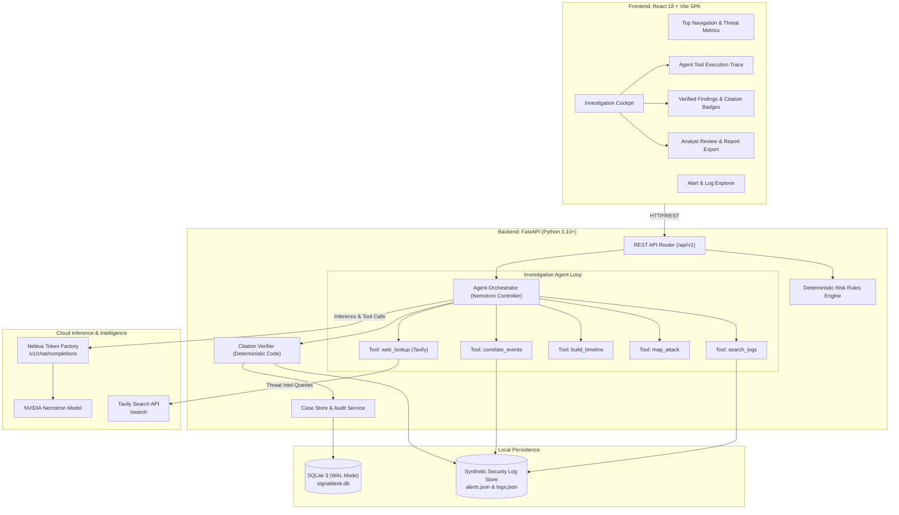
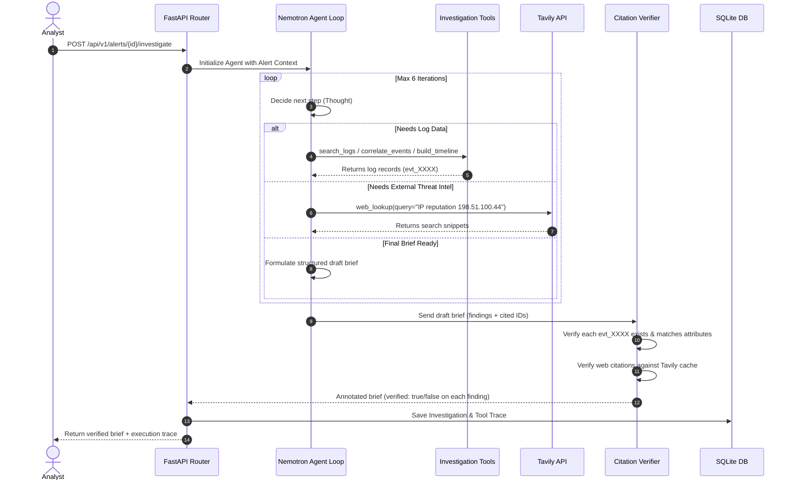
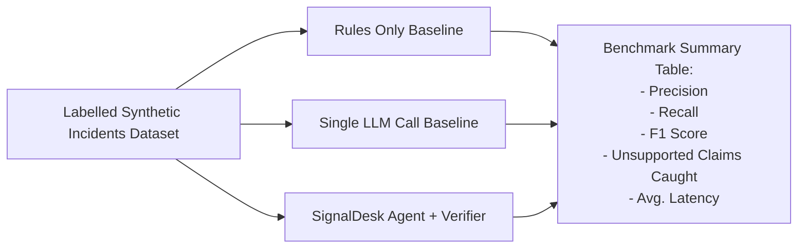

# Technical Requirements Document (TRD)
## SignalDesk AI — System Architecture & Engineering Specification

---

### Document Metadata
- **Project Name:** SignalDesk AI
- **Document Version:** 2.0.0 (Agent Loop & Citation Verifier Architecture)
- **Track:** Apps & Agents — Nebius x NVIDIA Global AI Hackathon
- **Primary Inference:** NVIDIA Nemotron on Nebius Token Factory
- **Threat Intelligence:** Tavily Search API
- **Last Updated:** 2026-10-18

---

## 1. System Architecture Overview



---

## 2. Technology Stack & Key Dependencies

### 2.1 Backend Stack
- **Language & Runtime:** Python 3.10+
- **Framework:** `FastAPI` (>= 0.110.0) with `uvicorn`
- **Inference Client:** `openai` (>= 1.20.0) or `httpx` (>= 0.27.0) targeted to Nebius Token Factory base URL
- **Threat Intel Client:** `tavily-python` (>= 0.3.0) or async `httpx` client for Tavily API
- **Validation:** `pydantic` (>= 2.6.0) & `pydantic-settings`
- **Persistence:** `SQLAlchemy` (>= 2.0.0) with SQLite (WAL mode)
- **Evaluation & Benchmarking:** `eval/run_benchmark.py` testing precision, recall, F1, and caught hallucinations across rule-only vs. single LLM vs. agent + verifier.

### 2.2 Frontend Stack
- **Framework:** React 18+ with Vite 5+
- **Styling:** Custom Vanilla CSS Design System with dark-mode SOC tokens, glassmorphism, and responsive CSS Grid/Flexbox.
- **Icons:** `lucide-react`
- **HTTP Client:** Native `fetch` with typed endpoint abstractions.

### 2.3 Cloud Providers & Credentials
- **Nebius Token Factory:**
  - Base URL: `https://api.tokenfactory.nebius.com/v1/`
  - Model: NVIDIA Nemotron (e.g. `nvidia/Llama-3_1-Nemotron-70B-Instruct-HF` or `nvidia/nemotron-4-340b-instruct`)
  - Authentication: `Bearer ${NEBIUS_API_KEY}`
- **Tavily Search API:**
  - Base URL: `https://api.tavily.com/search`
  - Authentication: `Bearer ${TAVILY_API_KEY}`
  - Used for live reputation lookup, CVE exploitation status, and threat actor intelligence.

---

## 3. The Multi-Step Agent Loop Specification

### 3.1 Agent Loop State Machine
The agent loop executes in a controlled cycle with a maximum recursion ceiling of 6 steps to guarantee bounded latency:



### 3.2 Registered Agent Tools
Each tool provides a strict schema:

1. **`search_logs(query: str, field: Optional[str], limit: int = 10) -> List[Dict]`**
   - Filters the synthetic log database by event type, username, IP, or keyword.
   - Returns structured records with their immutable `event_id` (e.g., `evt_0412`).

2. **`correlate_events(pivot_field: str, pivot_value: str, time_window_minutes: int = 60) -> List[Dict]`**
   - Discovers all events sharing a common entity (e.g., same `source_ip` or `target_account`) within a temporal window.

3. **`build_timeline(event_ids: List[str]) -> List[Dict]`**
   - Sorts requested event IDs chronologically and returns a timeline representation showing delta times.

4. **`map_attack(technique_or_behavior: str) -> Dict`**
   - Maps observed behavior to MITRE ATT&CK technique IDs (e.g., `T1110.004 Credential Stuffing`, `T1078 Valid Accounts`).

5. **`web_lookup(query: str) -> Dict`**
   - Calls the Tavily Search API for real-time external intelligence regarding malicious IPs, threat actor signatures, or CVEs.

---

## 4. Citation Verifier Engine

### 4.1 Verification Algorithm
The deterministic verifier enforces strict evidence grounding:
1. **Extraction:** Extracts all citations from `findings[i].evidence` array.
2. **Event Verification:**
   - For citations matching `evt_[0-9]+`:
     - Checks that the ID exists in the active log store.
     - Checks that claimed fields (e.g., failed login count, timestamp, IP) align with the corresponding raw log fields.
3. **Web Citation Verification:**
   - For citations matching `web:tavily:[a-z0-9_]+`:
     - Checks that the citation maps to an actual Tavily search result retrieved during the agent loop.
4. **Outcome Assignment:**
   - If all cited evidence items pass: `verified: true`.
   - If any citation is missing from the logs or contradicts the data: `verified: false`, and an `unverified_claim_reason` string is appended.

---

## 5. REST API Endpoints Specification

### 5.1 Alert & Investigation Endpoints

#### `GET /api/v1/alerts`
- Returns list of available alerts (synthetic scenarios + custom ingested).

#### `GET /api/v1/alerts/{alert_id}`
- Returns alert metadata, raw initial event, and associated event logs.

#### `POST /api/v1/alerts/{alert_id}/investigate`
- **Request Body (Optional settings):**
  ```json
  {
    "mode": "agent", 
    "enable_web_lookup": true
  }
  ```
  *(Modes supported: `agent` for full agent loop + verifier, `single_llm` for baseline comparison, `rules_only` for heuristic baseline).*

- **Response `200 OK` Schema:**
  ```json
  {
    "investigation_id": "inv_01HZ89AB",
    "alert_id": "alt_001",
    "mode": "agent",
    "deterministic_risk": {
      "score": 85,
      "severity": "HIGH",
      "triggered_rules": [
        {
          "rule_id": "R-101",
          "name": "Rapid Authentication Failure Burst",
          "weight": 50
        }
      ]
    },
    "agent_trace": [
      {
        "step": 1,
        "action": "search_logs",
        "input": {"query": "198.51.100.44"},
        "result_summary": "Found 26 authentication events (25 failures, 1 success)"
      },
      {
        "step": 2,
        "action": "web_lookup",
        "input": {"query": "198.51.100.44 threat intelligence reputation"},
        "result_summary": "Tavily reported IP flagged in recent brute force campaigns"
      }
    ],
    "brief": {
      "incident_type": "Credential stuffing followed by account takeover",
      "severity": "high",
      "confidence": "high",
      "findings": [
        {
          "claim": "25 failed logins from one IP in 4 minutes, then a successful login",
          "evidence": ["evt_0412", "evt_0413", "evt_0437"],
          "verified": true
        },
        {
          "claim": "Source IP is associated with known credential-stuffing activity",
          "evidence": ["web:tavily:result_1"],
          "verified": true
        }
      ],
      "attack_techniques": ["T1110.004 Credential Stuffing", "T1078 Valid Accounts"],
      "missing_information": [
        "Was MFA completed on the successful login?",
        "Is this IP range expected for this user?"
      ],
      "recommended_actions": [
        "Review the account's session history",
        "Confirm activity with the account owner",
        "Check for related events on other accounts"
      ],
      "human_review_required": true
    },
    "verifier_metrics": {
      "total_claims": 2,
      "verified_claims": 2,
      "unsupported_claims_caught": 0
    }
  }
  ```

#### `POST /api/v1/investigations/{investigation_id}/verdict`
- Analyst submits verdict (`ACCEPT`, `DISMISS`, `NEEDS_MORE_INVESTIGATION`), custom notes, and severity adjustment.

#### `GET /api/v1/cases/{case_id}/export`
- Exports investigation brief and audit history as Markdown or JSON.

---

## 6. Evaluation Benchmark Architecture (`eval.run_benchmark`)

The project includes an empirical benchmark module to validate the three methodologies:



Run via CLI:
```bash
python -m eval.run_benchmark
```
Outputs a formatted markdown table matching the project README specifications.
