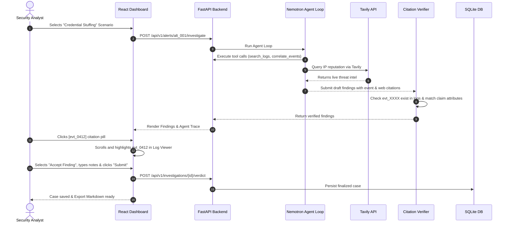

# UI/UX Design Specification & Application Flow
## SignalDesk AI — Modern SOC Analyst Cockpit with Agent Execution Trace

---

### Document Metadata
- **Project Name:** SignalDesk AI
- **Document Version:** 2.0.0 (Agent Loop & Citation Drill-down)
- **Theme Paradigm:** Modern Cyber Defense Dark Mode (SOC Cockpit)
- **Design Principles:** Verifiable Evidence Highlighting, Live Agent Observability, Zero-Distraction Ergonomics
- **Last Updated:** 2026-10-18

---

## 1. Design System & Visual Tokens

### 1.1 Color Palette
```css
:root {
  /* Surfaces & Canvas */
  --bg-primary: #0a0e17;         /* Deep space navy/obsidian */
  --bg-surface: #111827;         /* Panel container background */
  --bg-surface-elevated: #1a2234; /* Card & hover background */
  --bg-glass: rgba(17, 24, 39, 0.85); /* Glassmorphic modal backdrop */
  
  /* Borders & Accents */
  --border-subtle: #1f2937;
  --border-active: #374151;
  --border-highlight: #4b5563;

  /* Typography */
  --text-primary: #f9fafb;
  --text-secondary: #9ca3af;
  --text-muted: #6b7280;
  --font-sans: 'Inter', -apple-system, BlinkMacSystemFont, sans-serif;
  --font-mono: 'JetBrains Mono', 'Fira Code', monospace;

  /* Severity Tokens */
  --sev-critical: #ef4444;       /* Neon Crimson */
  --sev-high: #f97316;           /* Signal Orange */
  --sev-medium: #f59e0b;         /* Amber Alert */
  --sev-low: #38bdf8;            /* Cyber Blue */

  /* Agent & Verifier Brand Accents */
  --nvidia-green: #76b900;       /* NVIDIA Brand Accent */
  --nebius-indigo: #4b5cff;      /* Nebius Token Factory Accent */
  --tavily-cyan: #06b6d4;        /* Tavily Live Search Accent */
  --verified-emerald: #10b981;   /* Citation Verified */
  --unverified-rose: #f43f5e;    /* Citation Flagged / Unverified */
}
```

---

## 2. Information Architecture & The 3-Column Layout

```text
+-------------------------------------------------------------------------------------------------------------------------+
|  [⚡ SignalDesk AI]  |  ACTIVE ALERTS: 12  |  CRITICAL: 3  |  [NVIDIA Nemotron: ● Ready]  |  [Tavily: ● Active]  | [Benchmark]  [+ Ingest] |
+-------------------------------------------------------------------------------------------------------------------------+
| COLUMN 1: LOGS & RULES           | COLUMN 2: AGENT BRIEF & TRACE          | COLUMN 3: ANALYST VERDICT HUB               |
|                                  |                                        |                                             |
| [Deterministic Risk]             | [Live Agent Loop Trace]                | [Analyst Review Decision]                   |
| Score: 85/100 (HIGH)             | 1. search_logs(query="198.51.100.44")  | (o) Accept Finding (Escalate to Incident)   |
| [!] R-101: 25 Auth Failures      | 2. correlate_events(account="admin")   | ( ) Dismiss (Mark as False Positive/Decoy)  |
|                                  | 3. web_lookup(Tavily: "IP reputation") | ( ) Needs More Investigation                |
| [Synthetic Log Viewer]           |                                        |                                             |
| -------------------------------- | [Verified Findings]                    | [Severity Override]                         |
| > evt_0412 | 12:00:01            | [✓ VERIFIED]                           | [ Low | Medium | High | CRITICAL ]          |
|   4625 Failed Logon (svc_admin)  | Claim: 25 failed logins from one IP in |                                             |
|                                  | 4 minutes, then a successful login     | [Remediation Actions (Advisory)]            |
| > evt_0413 | 12:00:04            | Citations: [evt_0412] [evt_0437]       | [x] Revoke Active User Tokens               |
|   4625 Failed Logon (svc_admin)  |                                        | [x] Block Source IP on Perimeter            |
|                                  | [✓ VERIFIED]                           | [ ] Isolate Host DC-PROD-01                 |
| > evt_0437 | 12:04:12            | Claim: Source IP is associated with    |                                             |
|   4624 Successful Logon          | known credential-stuffing activity     | [Analyst Rationale / Notes]                 |
|                                  | Citations: [web:tavily:result_1]       | [ Confirmed credential stuffing attack... ] |
| (Clicking a citation jumps to    |                                        |                                             |
| and highlights the event above!) | [Missing Information Checklist]        | [ Submit Verdict & Close Case ]             |
|                                  | [?] Was MFA completed on success?      | [ Export Case Brief (Markdown/JSON) ]       |
+----------------------------------+----------------------------------------+---------------------------------------------+
```

---

## 3. Interactive Component Details

### 3.1 Column 1: Log Store & Heuristic Rules
- **Event List:** Chronological log stream with instant visual badges (`evt_0412`, `evt_0413`, etc.).
- **Click-to-Inspect:** Clicking any log displays parsed JSON attributes, event codes, timestamps, and usernames.
- **Rule Engine Output:** Independent risk score computed deterministically, showing triggered rules and severity weights without AI influence.

### 3.2 Column 2: Agent Execution Trace & Verified Findings
- **Agent Stepper Trace:** Expandable accordion showing the step-by-step reasoning:
  - `Step 1`: Agent thought + `search_logs` call and response summary.
  - `Step 2`: Agent thought + `correlate_events` pivot.
  - `Step 3`: Agent thought + `web_lookup` (Tavily query badge).
- **Verified Findings Card:**
  - Each finding shows the extracted claim.
  - **Interactive Citation Pills:**
    - `[evt_0412]` (Green): Clicking scrolls the left-hand log viewer directly to `evt_0412` with a pulsating green outline.
    - `[web:tavily:result_1]` (Cyan): Clicking triggers a hover tooltip displaying the Tavily threat intelligence search snippet.
    - `[UNVERIFIED CLAIM]` (Red Warning): Displays if the Citation Verifier determined the claim has no basis in the log database.
- **Attack Techniques:** MITRE ATT&CK badges (e.g., `T1110.004 Credential Stuffing`).
- **Missing Information Checklist:** Explicit list of items the analyst must confirm.

### 3.3 Column 3: Analyst Verdict & Decision Hub
- **Review Radios:** `Accept Finding`, `Dismiss Finding`, `Needs More Investigation`.
- **Severity Override:** Allows analyst to upgrade or downgrade the suggested severity.
- **Remediation Checklist:** Human-in-the-loop action recommendations (strictly advisory, never executed autonomously).
- **Export Action:** Instantly generates and downloads a clean, professional Markdown or JSON investigation summary.

### 3.4 Modal: Benchmark Evaluation Runner (`Benchmark Modal`)
- Accessible from the top navigation bar.
- Shows live or pre-computed results from `python -m eval.run_benchmark`:
  - **Rules Only vs. Single LLM Call vs. SignalDesk Agent + Verifier**.
  - Side-by-side metrics: Precision, Recall, F1 Score, Unsupported Claims Caught, and Execution Latency.

---

## 4. End-to-End Application Flow


